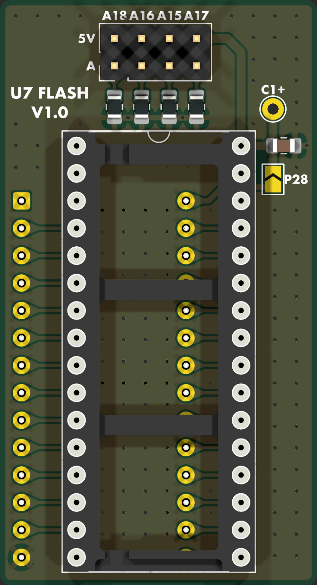
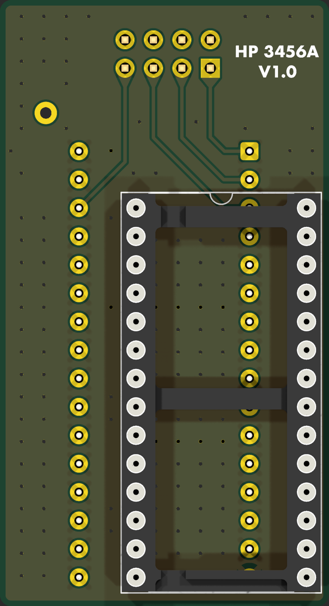

# U7 Flash Adapter

A small PCB that runs an SST39SF040 flash chip in the 28-pin U7 socket of the HP 3456A A4 controller
board. It replaces the hand-wired chip in [`docs/U7_FLASH_ADAPTER.md`](../../docs/U7_FLASH_ADAPTER.md):
the flash chip stays stock, so it moves between the adapter and the TL866 without bending any legs.

**Status (2026-10-24):** V1.0, designed and checked (DRC, ERC and lint all clean). Not yet ordered
or tested in a meter. See [Open items](#open-items) before ordering.

| Front | Back |
| --- | --- |
|  |  |

## How it works

- **Plug (J2):** a DIP-28 pin pattern under the board plugs into U7. It uses the 27256 pinout,
  and pin 1 (VPP) is not connected.
- **Socket (U1):** the 32-pin socket sits 5.1 mm to the right of the plug and two rows higher, so
  plug pin *n* and flash pin *n*+2 share a row. All 26 signals and GND are one straight trace each.
- **Read-only:** WE# is tied to +5V, so the chip is never written in the meter.
- **Power:** there are two ways to feed +5V, and the board ships with neither connected.
  - **JP1** (silk `P28`) joins U7 pin 28 to +5V. It is open as built. Bridge it only after U7
    pin 28 measures +5 V with the meter on and the chip out. Nobody has checked yet what the A4
    board puts on that pin.
  - **TP1** (silk `C1+`) is a wire pad. Run a wire from it to the + end of the meter's C1, the
    same way the hand-wired chip is powered.

  C1 on the adapter (100 nF) decouples U1 pin 32.
- **Bank select (J1):** 10k resistors (R1–R4) pull A15–A18 low, so with no jumpers the chip reads
  bank 0 (the first 32K). A jumper from an A pin to the 5V pin above it sets that bit to 1.
  Bank *n* is the 32K block at offset *n* × $8000. The columns are labelled A18 A16 A15 A17, in
  routing order. `u7fixed_512K.bin` repeats the image in all 16 banks, so jumpers only matter if
  you store different images.

## Parts

| Ref | Part | Notes |
| --- | --- | --- |
| U1 | 32-pin 600 mil turned-pin DIP socket | holds the SST39SF040 |
| J2 | 28-pin 600 mil DIP plug: two 1x14 machined male pin strips, or a machined-pin DIP header | soldered from the bottom, long pins down into U7 |
| J1 | 2x4 pin header, 2.54 mm, plus jumpers | bank select |
| R1–R4 | 10k, 0805 | A15–A18 pull-downs |
| C1 | 100 nF, 0805, 25 V or more | decoupling |
| JP1 | solder jumper (on the PCB) | U7 pin 28 to +5V |
| TP1 | wire pad (on the PCB) | +5V from the meter's C1 |

A plain DIP socket can't be J2: its pins are too short to reach through the board into U7, and a
long-tail (wire-wrap) socket would need its body on top, where U1 sits.

## Assembly

1. Solder the 0805 parts (R1–R4, C1) first.
2. Fit J1.
3. Fit U1 on the top.
4. Fit J2 from the bottom, with the long pins pointing down. Solder J2 on the top, inside U1's
   open frame, before the chip goes in. The B silk shows J2's outline and pin-1 notch.
5. Power: either bridge JP1 (only once pin 28 is confirmed as +5 V), or wire TP1 to the meter's C1.
6. Before fitting it in the meter, with no chip in, check for no short from +5V to GND. Then check
   each J2 pin to its U1 pin, n to n+2.

U1's notch and J2's pin 1 both face the same end, toward the board edge as the chip sits now.

## Fabrication

2-layer, 1.6 mm, 29.4 x 54.2 mm, JLC default rules. Gerbers and drill files are in
`production/HP_3456A_U7_Flash_Adapter_1.0.zip`. It's a bare-PCB order: all parts are hand-soldered,
and the BOM and positions files are not needed. Five boards cost about $4 plus shipping.

## Files

| Path | Contents |
| --- | --- |
| `U7-Flash-Adapter.kicad_sch` / `.kicad_pcb` | KiCad 10 project |
| `U7-Flash-Adapter.pdf` | schematic |
| `production/` | gerbers and drill files (zip), BOM, positions |
| `renders/Routing-*.png`, `Render-Copper.png` | copper views |
| `style_lint.ignore` | accepted lint items (parts aligned to the 2.54 mm pin rows, off the 0.1 mm grid) |

The schematic and board were generated by scripts in the author's (private) kicad-tools repo
(`projects/u7-adapter/`). Edit the KiCad files directly; they are the source of truth here.
`pth_inside_courtyard` is set to ignore in the project, because the plug and the socket overlap by
design.

## Open items

- [ ] Measure U7 pin 28 against pin 14 with the chip out and the meter on, to decide JP1 or TP1.
- [ ] Measure the clearance around U7. The adapter overhangs U7: the board reaches about 5 mm past
      the plug on the right (the socket and C1 strip) and 18 mm past pin 1 (the bank header). It
      also sits about 12 mm higher than the bare chip.
- [ ] Order the PCB, build one, and run the checks in `docs/HARDWARE_VALIDATION.md`.
